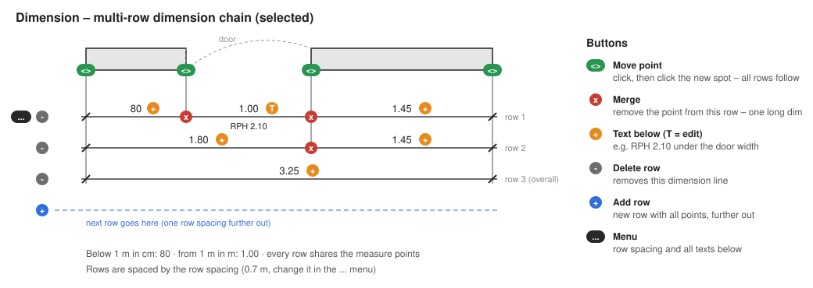

<h1> ArchitecturalAtelierTools</h1>

Rhino 8 tools for architectural drawings.

| Icon | Command | What it does |
|------|---------|--------------|
|  | `A01_Pre_Preferences` | Sets the layer each tool draws on. |
|  | `A02_Dim_Dimension` | Multi-row dimension chains: `80` below 1 m, `1.20` from 1 m. |
|  | `A03_BI_BattInsulation` | Draws the batt insulation line along a curve. |

## Install

Download the `.yak` from [Releases](../../releases) and drag it into Rhino 8, or install `ArchitecturalAtelierTools` via `_PackageManager`. Restart Rhino.

---

## A01_Pre_Preferences

Run `A01_Pre_Preferences` to set the layer per tool. Further defaults can be set in `Dimension.json` / `BattInsulationLine.json` in `%APPDATA%\ArchitecturalAtelierTools\`.

**Saved configs**: *Save as...* stores the current settings of all tools under a name (e.g. one per office standard or project), *Load* puts one back into the window (click *Save* to use it), *Delete* removes it. They are kept in `%APPDATA%\ArchitecturalAtelierTools\configs\<name>\`.

---

## A02_Dim_Dimension



1. Run `A02_Dim_Dimension`, set `Scale` (`1_100`, `1_50`, `1_25`) and `Rows`.
2. Pick the points, press **Enter**.
3. Click where the first dimension line goes.

Every row gets all points; the last row is the overall dimension.

**Buttons on a selected chain** – hover a button to see what it does (with a preview for remove / add / delete). Move buttons work by dragging (press, drag with osnaps, release) or by click + click.

- **`•`** (teal) on every point of every dimension line – move that point in this row only
- **`<>`** move a measure point (in every row)
- **`↕`** (purple) after each row – move that dimension line
- **`+`** (green) at both ends of a row – extend the row with more points, **Enter** when done
- **`x`** remove a point from a row
- **`-`** delete a row
- **`+`** add a row
- **`+` / `T`** (orange) add or edit a text below a dimension, e.g. `RPH 2.10`
- **`...`** chain menu: scale, row spacing and texts below

**Row spacing follows the scale**: 0.7 m at 1:100, 0.35 m at 1:50, 0.175 m at 1:25. Switching a chain to another scale (in the `...` menu or by changing its annotation style in Properties) moves its rows to the distance of the new scale. A spacing set in the menu is kept relative to the scale. `ResetStyle` also re-spaces all chains.

**Styles**: `Dimension_1_100`, `Dimension_1_50`, `Dimension_1_25` – Arial Narrow, ticks, text height 0.2 m at 1:100, 0.1 m at 1:50, 0.05 m at 1:25 (ticks, gaps and row spacing scale the same way). Sizes in `Dimension.json` are metres at 1:100 (`text_height`). The chosen one becomes current, so `_Dim` uses it too.

Dimensions are normal Rhino dimensions, grouped per chain.

**Tip: Rhino's grips work too.** Turn on the grips of a chain dimension (F10) and drag a point or the dimension line. The rest of the chain follows: a moved point moves in every row that has it, a moved dimension line takes its whole row along. This only works once `A02_Dim_Dimension` has been started in the current Rhino session. To have it on as soon as Rhino opens, add `A02_Dim_Dimension _Update` under *Tools → Options → General → Run these commands every time Rhino starts*.

---

## A03_BI_BattInsulation


1. Run `A03_BI_BattInsulation`.
2. Pick a curve, or press **Enter** to draw a polyline.
3. Type the band width and press **Enter**.

Options: `Spacing` (0 = auto), `Corner` (`Miter`, `ButtIncoming`, `ButtOutgoing`), `CrossingLoops` (`Trim`, `Remove`), `Rhythm` (`Continuous`, `Restart`).


## Development

```
commands/   one .cs file per command
icons/      plugin and command icons
docs/       drawings for this README
build.ps1   builds the .yak package
```

Release (Rhino must be running):

```powershell
.\build.ps1 -Version 1.1.0 -Feed "\\SERVER\share\RhinoPackages"
```

Open for forking – contributions welcome.
